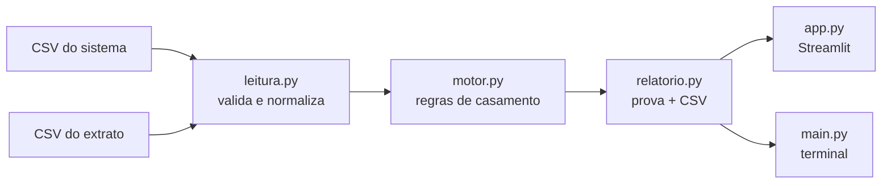

# Conciliação Bancária para Agência de Turismo

[](https://github.com/anavieira1/conciliacao_turismo/actions/workflows/testes.yml)


Ferramenta em Python que compara os lançamentos do sistema financeiro de uma
agência de turismo com o extrato do banco, casa cada item e **explica cada
diferença**: taxa da maquininha de cartão, pagamento ainda não compensado,
tarifa bancária não registrada ou valor divergente.

## O problema

No fim do mês, o financeiro precisa provar que o saldo do banco bate com o do
sistema. Na prática, isso é feito à mão no Excel, linha por linha:

- vendas no cartão caem no banco **com desconto da adquirente**, então o valor
  nunca bate exatamente;
- pagamentos compensam **dias depois** do lançamento;
- tarifas, IOF e depósitos não identificados aparecem **só no extrato**.

Este projeto automatiza esse trabalho e entrega a lista do que precisa de ação.

## O que ele faz

Com os dados de exemplo (12 lançamentos no sistema, 13 no extrato):

| Situação                        | Itens | O que o financeiro faz              |
|---------------------------------|:-----:|-------------------------------------|
| Conciliado                      | 7     | Nada                                |
| Conciliado c/ taxa de cartão    | 2     | Lançar a taxa (3%) como despesa     |
| Divergente (valor diferente)    | 1     | Verificar com o cliente os R$ 90 a menos |
| Só no sistema                   | 2     | Aguardar compensação                |
| Só no extrato                   | 3     | Registrar tarifa, IOF e identificar depósito |

Tudo isso aparece num **app web** (Streamlit), com upload dos CSVs, indicadores,
filtro e download do resultado para Excel, ou numa **versão de terminal**.

## Como a conciliação funciona



As regras são aplicadas em ordem ([motor.py](conciliacao/motor.py)):

1. **Por documento** (PIX, TED, boleto, cartão), a chave mais confiável.
   - Valor igual → conciliado.
   - Venda no cartão que entrou até 5% menor → conciliado com taxa da adquirente.
   - Qualquer outra diferença → divergente.
2. **Por valor + data**, para lançamentos sem documento: mesmo valor com até
   3 dias de diferença, escolhendo a data mais próxima.
3. **O que sobrar** vira pendência, com uma sugestão do que fazer.

No fim, a **prova da conciliação** parte do saldo do banco e chega ao saldo do
sistema somando cada diferença explicada. O app também confere o saldo final
impresso no extrato contra a soma das linhas do arquivo, para detectar um
extrato exportado incompleto.

## Decisões técnicas

- **`Decimal` em vez de `float` para dinheiro.** `0.1 + 0.2` não dá `0.3` em
  float; em conciliação, um centavo de erro quebra a prova.
- **Motor sem dependência de interface.** `conciliacao/` não importa Streamlit,
  então a mesma lógica serve ao app, ao terminal e aos testes, e poderá servir
  a uma API.
- **Modelos imutáveis** (`dataclass(frozen=True)`) e `Enum` para os status:
  nenhum lançamento é alterado no meio do processo.
- **Entrada do mundo real:** aceita `1.234,50` e `1234.50`, `02/11/2026` e
  `2026-11-02`, e CSV salvo pelo Excel em latin-1. Erros de formato viram uma
  mensagem com o número da linha, não um traceback.
- **Saída pronta para o Excel brasileiro:** CSV com `;`, vírgula decimal e BOM.

## Testes

34 testes com pytest cobrem as regras de casamento, a leitura dos arquivos e a
prova da conciliação. Eles rodam no GitHub Actions a cada push.

```bash
pip install -r requirements-dev.txt
python -m pytest
```

Escrever os testes revelou dois bugs, corrigidos com teste de regressão:

- **A prova da conciliação nunca falhava.** O saldo do banco e o do sistema
  eram calculados a partir das mesmas linhas, então a "diferença não
  explicada" era sempre zero, mesmo com metade do extrato faltando. A correção
  compara com o saldo final impresso pelo banco.
- **Um valor como `R$ 100,00` derrubava o app.** `decimal.InvalidOperation`
  não herda de `ValueError` e escapava do tratamento de erro.

## Rodar no computador

```bash
pip install -r requirements.txt
streamlit run app.py      # versão web, abre no navegador
python main.py            # versão terminal
```

## Formato dos arquivos (CSV separado por `;`)

**Sistema:** `id;data;descricao;tipo;categoria;valor;documento`
(`tipo` = RECEITA ou DESPESA, valor sempre positivo)

**Extrato:** `id;data;historico;valor;documento`
(valor negativo = saída)

Modelos para baixar ficam na barra lateral do app. Os dados em `dados/` são
fictícios.

## Estrutura

```
conciliacao/
  modelos.py     lançamentos e resultado (dataclasses + Enum)
  leitura.py     leitura e validação dos CSVs
  motor.py       regras de casamento
  relatorio.py   prova da conciliação, relatório e CSV
app.py           interface web (Streamlit)
main.py          versão de terminal
tests/           testes com pytest
```

## Próximos passos

- [ ] API REST com FastAPI usando o mesmo motor
- [ ] Histórico de conciliações em PostgreSQL
- [ ] Docker e deploy da API
- [ ] Importar extrato em OFX, o formato padrão dos bancos

## Publicar na nuvem (Streamlit Community Cloud)

1. Entre em share.streamlit.io com a conta do GitHub e clique em **Create app**.
2. Escolha este repositório, branch `main` e arquivo `app.py`.
3. Em **Advanced settings**, use Python 3.12 e, em **Secrets**, cole:
   ```toml
   SENHA_APP = "uma-senha-forte"
   ```
4. Clique em **Deploy**. Cada `git push` na `main` atualiza o app.

## Segurança

- Com `SENHA_APP` configurada, o app pede senha antes de mostrar qualquer dado
  (comparação com `hmac.compare_digest`, resistente a ataque de tempo).
- **Nunca** coloque extratos reais em `dados/` nem no GitHub: envie-os só pela
  tela do app. Eles ficam na memória durante o uso e não são gravados.
- `secrets.toml` e `saida/` estão no `.gitignore`.
